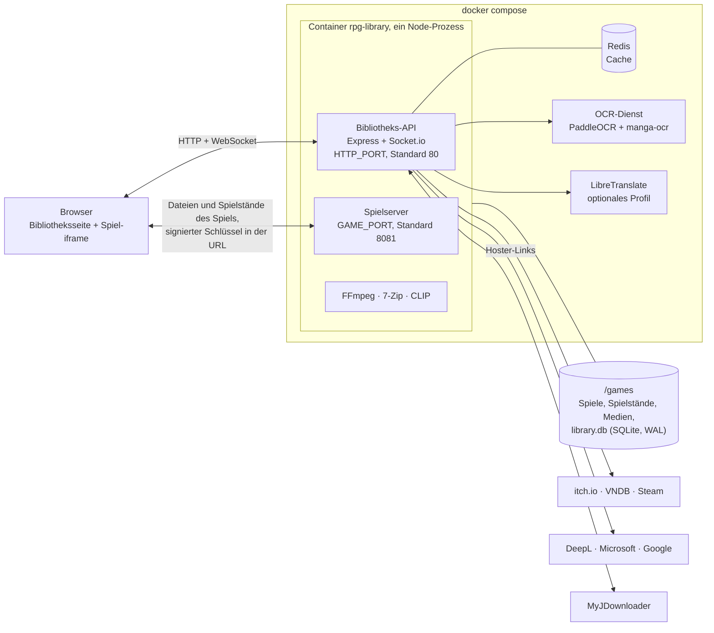
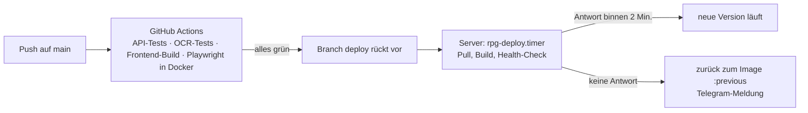

<div align="center">

<picture>
  <source media="(prefers-color-scheme: light)" srcset="rest/img/mimikin-light.png">
  
</picture>

# Mimikin

Eine selbst gehostete Bibliothek für RPG-Maker-MV- und -MZ-Spiele. Archiv hochladen, und das Spiel läuft im Browser-Tab, auch auf dem Handy.

[English](README.md) | [Русский](README.ru.md) | Deutsch

[](https://github.com/Raven632/rpg-library/releases)
[](https://github.com/Raven632/rpg-library/actions)
[](LICENSE)

[](#schnellstart)


</div>

Spiele aus RPG Maker MV und MZ sind HTML5-Apps, verpackt in NW.js. Mimikin liefert den Spielordner von deinem Server aus und ersetzt die NW.js-Teile durch Browser-Code (`api/public/rpg-fixes.js`). So läuft eine Windows-Version in Safari auf dem iPhone. Die Spielstände liegen auf dem Server: am Schreibtisch anfangen, auf dem Sofa weiterspielen.

Drumherum steckt eine Bibliothek. Sie holt Cover und Beschreibungen von itch.io, VNDB und Steam, baut aus den Bilddateien des Spiels eine Galerie und übersetzt ein Spiel maschinell, ohne ein Byte auf der Platte zu ändern.

Das Logo ist ein Mimic, die Schatztruhe, die zubeißt. Er wohnt in der Kopfzeile. Solange der Server arbeitet, kaut er. Drückst du auf „Spielen“, schnappt er zu, und landet ein neues Spiel im Regal, hüpft er und lässt eine Münze fallen. Versteckst du die Cover mit `H`, macht er die Augen zu.

<table>
  <tr>
    <td width="78%" valign="top"></td>
    <td width="22%" valign="top"></td>
  </tr>
  <tr>
    <td align="center"><sub>Die Bibliothek. Alle Titel sind erfunden; das Demo-Set liegt im Repository.</sub></td>
    <td align="center"><sub>Dieselbe Bibliothek auf dem Handy.</sub></td>
  </tr>
  <tr>
    <td colspan="2"></td>
  </tr>
  <tr>
    <td colspan="2" align="center"><sub>Das Spielfenster: links Cover, Status und „Play“, rechts Beschreibung und Reiter.</sub></td>
  </tr>
</table>

## Was es kann

### Spielen

- PC-Versionen laufen im Handy-Browser. `rpg-fixes.js` liefert nach, was NW.js sonst bieten würde: Dateizugriff, Ton auf dem iPhone, Videos, Schriften, Ordnernamen in falscher Groß- und Kleinschreibung.
- Spielstände liegen auf dem Server. Überschriebene Slots landen im „Spielstand-Verlauf“ (die letzten fünf, danach einer pro 10 Minuten, bis zu 30 je Slot). Ein offline gemachter Spielstand überschreibt nie einen neueren von einem anderen Gerät.
- `P` merkt sich einen Moment: ein Screenshot plus ein Spielstand, von dem aus du weiterspielen kannst. Das Spiel setzt außerdem Rücksprungpunkte vor Szenen, Entscheidungen, Kämpfen und Kartenwechseln, und `Backspace` spult zurück, bis auf eine einzelne Dialogzeile. Der „Weg“ listet den Durchlauf Tag für Tag auf.
- Ein Menü im Spiel: Turbo ×3, ein Cheat-Menü (Gruppe, Items, Variablen, Schalter, Teleport, Szenen freischalten), Speichern an jeder Stelle der Karte, Gamepad auf dem Bildschirm und echte Gamepads, Strecken und Glätten.
- Spiele kommen von einem zweiten Port. Die Skripte eines Spiels erreichen die API der Bibliothek nicht und rufen keine fremden Seiten auf.

### Galerie

- Aus den Dateien des Spiels gebaut, du musst also nicht erst spielen: CG, Figuren und Hintergründe in Alben, Bildfolgen als Animation, Videos, ein Soundraum, Spine- und Live2D-Modelle.
- „Szene ansehen“ spielt ein Album so ab, wie das Spiel es inszeniert, mit Dialog und Ton.
- Suche nach dem, was zu sehen ist, in deiner Sprache getippt. Das CLIP-Modell läuft auf deinem Server.
- `H` versteckt Cover und Tab-Titel auf einmal. Im Spiel macht es außerdem den Bildschirm schwarz und schaltet den Ton stumm.

### Bibliothek

- Cover, Screenshots, Beschreibungen, Tags, Entwickler und Erscheinungsdatum kommen von itch.io, VNDB und Steam. Jeder Treffer wird mit allen Namen des Spiels abgeglichen (Ordner, Archiv, Readme). Passt nichts, listet das Spielfenster unter „Vielleicht ist es dieses“ ähnliche Treffer auf. Du kannst auch „Bearbeiten“ drücken und einen Link einfügen.
- Der Status folgt deiner Spielzeit („Spiele gerade“, „Nicht begonnen“). „Was spielen?“ wählt etwas aus, das du noch nicht angefangen hast.
- Neuerscheinungen aus dem itch.io-Katalog nach Tag, Zeitraum, Preis und Plattform, mit einer Liste „Will ich spielen“.
- Eine Audit-Seite: Spielzeit, fehlende Daten, Duplikate, die schwersten Spiele, Speicherplatz, Fehler, die deine Geräte gemeldet haben. Gelöschte Spiele bleiben 30 Tage im Papierkorb.
- Uploads in jeder Größe, auch vom Handy. Ein abgebrochener Upload setzt dort fort, wo er stand, auch von einem anderen Gerät aus. Archive mit Passwort und Archive in Archiven werden entpackt.
- Füge einen Link zu einem Datei-Hoster ein, dein MyJDownloader lädt die Datei, und die Bibliothek installiert, was ankommt. Ein Ordner `_inbox` und eine SFTP-Seedbox funktionieren genauso.
- Beim Aktualisieren bleiben Spielstände, Spielzeit und Daten erhalten. Die alte Version wandert nach `_old` und kommt mit einem Klick zurück.

### Übersetzen

- Maschinelle Übersetzung von MV/MZ-Spielen auf dem Server: Dialoge, Plugin-Parameter und Beschriftungen auf Bildern (PaddleOCR und manga-ocr). Der Spielserver tauscht den Text beim Ausliefern der Dateien aus, das Spiel auf der Platte bleibt also im Original, und die Übersetzung lässt sich sofort ausschalten.
- Die Engines kommen der Reihe nach dran: DeepL, Microsoft, Google, LibreTranslate. Ist bei einer das kostenlose Monatskontingent aufgebraucht, übernimmt die nächste, und jede Zeile wird nur einmal für alle Spiele übersetzt. Die Schlüssel trägst du unter ⋯ → Einstellungen → Übersetzung ein.

### Selbst betreiben

- Ein Befehl: `docker compose up -d --build`. Redis und der OCR-Dienst starten mit; LibreTranslate ist ein optionales Profil.
- Oberfläche auf Englisch, Russisch und Deutsch. Änderungen erscheinen sofort auf allen offenen Geräten.
- Die Anmeldung erlaubt 10 Versuche in 15 Minuten. In den Einstellungen eingetragene Schlüssel werden mit AES-256-GCM gespeichert. Telegram schickt, wenn du es verbindest, fertige Uploads, die tägliche Sicherung und Problemmeldungen.
- In `deploy/` liegen systemd-Units für eine nächtliche Sicherung und ein Pull-Update, das auf das vorige Image zurückgeht, wenn das neue nicht binnen zwei Minuten antwortet.

## So hängt es zusammen



Bibliothek und Spiele liegen auf zwei Ports. Ein Spiel erreicht seine Dateien und Spielstände nur über einen signierten Schlüssel in seiner URL, deshalb kann selbst ein feindliches Spielskript die Bibliothek nicht lesen.

## So kommt es auf den Server

Jeder Push auf `main` startet vier GitHub-Actions-Jobs: API-Tests (Node, Redis, ffmpeg), OCR-Tests, Lint und Build der Oberfläche sowie 197 Playwright-Tests in Docker ohne Netzzugang. Sind alle vier grün, schiebt CI den Branch `deploy` weiter. Der Server fragt die GitHub-API nie ab. Ein systemd-Timer prüft diesen Branch jede Minute, baut neu und wartet, bis die Seite antwortet. Kommt binnen zwei Minuten keine Antwort, stellt das Skript das vorige Image wieder her und schickt eine Telegram-Meldung.



## Schnellstart

Du brauchst Linux mit Docker Engine. Docker Desktop geht auch, aber große Archive sind durch dessen VM langsam. Ein fertiges Image gibt es nicht; Compose baut es aus diesem Repository.

```bash
git clone https://github.com/Raven632/rpg-library.git
cd rpg-library
cp .env.example .env              # optional; jede Einstellung ist darin beschrieben (die Kommentare sind auf Russisch)
docker compose up -d --build      # der erste Build lädt die OCR-Modelle, einige hundert MB
```

Öffne `http://<server>` und lege das Konto des Besitzers an. Der Server startet auch ohne `.env`. Das sind die Einstellungen, die du am ehesten anfasst:

| Variable | Standard | Wirkung |
|---|---|---|
| `SESSION_SECRET` | wird beim ersten Start erzeugt | Eigener Schlüssel: `openssl rand -hex 64` |
| `HTTP_PORT` | `80` | Die Bibliothek |
| `GAME_PORT` | `8081` | Die Spiele. Beide Ports müssen von deinen Geräten erreichbar sein (Heimnetz, Tailscale) |
| `GAMES_HOST_DIR` | `./games` | Wo Spiele, Spielstände und Datenbank liegen |
| `SCRAPER_API_KEY` | keiner | Kostenloser ScraperAPI-Schlüssel (1000 Credits im Monat) für itch.io-Seiten. Eine Seite kostet 10 Credits; `SCRAPER_DAILY_LIMIT` begrenzt einen Tag auf 30. VNDB und Steam brauchen keinen Schlüssel |
| `TELEGRAM_BOT_TOKEN` | keiner | Benachrichtigungen. Danach ⋯ → Einstellungen → Benachrichtigungen → Verbinden |
| `COMPOSE_PROFILES` | keiner | `libretranslate` fügt einen eigenen Übersetzer hinzu (einige GB Modelle, 2 bis 4 GB Arbeitsspeicher) |

Übersetzer-Schlüssel, MyJDownloader, die Seedbox und den Telegram-Chat kannst du auch später unter ⋯ → Einstellungen eintragen.

Um dich erst einmal umzusehen, füll die Bibliothek mit sechzehn erfundenen Spielen:

```bash
docker compose exec rpg-library node scripts/demo-library.js /games
```

<details>
<summary><b>Wohin die Dateien kommen</b></summary>

`GAMES_HOST_DIR` wird als `/games` eingebunden:

- `/games/<Spiel>`: die Spiele, entpackt. In den Ordner eines Spiels wird nie etwas geschrieben.
- `/games/library.db`: die Datenbank.
- `/games/_saves`: Cloud-Spielstände. `_saves/.history` hält frühere Versionen der Slots.
- `/games/_media`: Cover, Screenshots, Galerie-Index und Vorschaubilder.
- `/games/_old`: frühere Versionen aktualisierter oder gepatchter Spiele.
- `/games/_trash`: gelöschte Spiele, 30 Tage lang.
- `/games/_inbox`: Archive, die sich von selbst installieren.
- `/games/_tmp_uploads`: laufende Uploads.

</details>

<details>
<summary><b>Entwicklung</b></summary>

```bash
docker compose -f docker-compose.yml -f docker-compose.dev.yml up -d --build
```

Die API startet von selbst neu, wenn sich `api/src` ändert (`node --watch`). Vite liefert die Oberfläche auf Port 5173 und sucht die API unter `HTTP_PORT` aus der `.env` (8080, wenn nicht gesetzt). Die Kompatibilitätsprüfung für Spiele läuft nur auf Anforderung: `docker compose -f docker-compose.yml -f docker-compose.dev.yml run --rm --build compat`, mit `COMPAT_USER` und `COMPAT_PASS` in der `.env`.

</details>

<details>
<summary><b>Tests</b></summary>

```bash
(cd api && npm ci && npm test)                # 287 Server- und HTTP-Tests; braucht ffmpeg, für http.test.js auch Redis
(cd frontend && npm ci && npm run lint)       # ESLint
tests/e2e/run.sh                              # 197 Playwright-Tests in Docker, offline, Desktop- und Handybreite
(cd ocr && python -m unittest test_pipeline)  # 13 OCR-Tests; brauchen numpy, pillow, opencv-python-headless
```

Die Servertests laufen im eingebauten Test-Runner von Node (`node:test`) und ohne Netz. Externe Quellen sind nachgebildet; Uploads und Spielserver laufen auf echten HTTP-Servern an freien Ports. Eine eigene Prüfung, `tests/compat`, öffnet jedes Spiel einer Bibliothek in Headless-Chromium und meldet die erreichte Szene. Die Screenshots oben stammen aus einer Demo-Bibliothek erfundener Spiele (`api/scripts/demo-library.js`).

</details>

## Unter der Haube

<details open>
<summary><b>Isolierung der Spiele</b></summary>

Spiele kommen von einer getrennten Origin (`GAME_PORT`). Seine Dateien und Spielstände bekommt ein Spiel nur über einen Schlüssel in der Adresse: ein HMAC aus dem Sitzungsgeheimnis, dem Spiel und seinem Ordner. Abmelden oder Austauschen des Spiels ändert ihn, und jeder Pfad muss im Ordner dieses Spiels bleiben. Eine Content-Security-Policy hindert den Code des Spiels daran, andere Seiten aufzurufen, und die API der Bibliothek prüft Fetch Metadata (`Sec-Fetch-Site`), sodass ein Spiel auch sie nicht aufrufen kann. Die Bibliothek öffnet das Spiel im Vollbild in einem Sandbox-Frame und spricht per `postMessage` mit ihm.

</details>

<details>
<summary><b>NW.js im Browser</b></summary>

`api/public/rpg-fixes.js` gibt PC-Versionen, was sie von NW.js erwarten: Ersatz für `fs` und `path` aus Node, einen eigenen `localStorage`-Bereich je Spiel, Cloud-Spielstände mit Offline-Warteschlange und Konflikterkennung, ein Touch-Gamepad, die Audio-Freischaltung für iOS und Fehlerberichte an den Server.

</details>

<details>
<summary><b>Uploads zum Fortsetzen</b></summary>

Archive gehen in Stücken hoch, die zur Verbindung passen (16 bis 256 MB), und werden über einen Fingerabdruck der Datei fortgesetzt: Name, Größe und ein Hash des ersten und letzten Megabytes. Das geht nach einem Neuladen und von einem anderen Gerät aus. Das Entpacken läuft im Hintergrund und wird nach einem Neustart des Servers zu Ende geführt. Auf iOS kommt die Antwort auf eine große Anfrage nie an, deshalb bestätigt die Seite jedes Stück mit einer kurzen Statusabfrage.

</details>

<details>
<summary><b>Spielstände und Zurückspulen</b></summary>

Geschrieben wird atomar (temporäre Datei, dann Umbenennen). Der Verlauf je Slot wird ausgedünnt: die letzten fünf, danach einer pro 10 Minuten, höchstens 30. Konflikte entscheidet die Speicherzeit des Clients. Rücksprungpunkte sind Spielstände, die ihren Durchlauf mittragen, deshalb folgt das Zurückspulen dem Durchlauf, in dem man gerade ist.

</details>

<details>
<summary><b>Updates und Patches ohne Kopien</b></summary>

Ein Patch wird über eine Kopie des Spiels aus Hardlinks gelegt (`cp -al`). Geänderte Dateien werden vor dem Ersetzen gelöst, sodass die vorherige Version ihre eigenen behält. Wohin die Dateien eines Patches gehören, ergibt sich aus dem Abgleich mit den Dateien des Spiels, ohne Beachtung der Groß- und Kleinschreibung.

</details>

<details>
<summary><b>Galerie-Index</b></summary>

Von jedem Bild werden nur die ersten 40 Bytes gelesen: PNG `IHDR`, WebP `VP8`/`VP8L`/`VP8X` und die verschlüsselten Header von RPG Maker liefern die Größe. Größe und Bytedichte sortieren Bilder in CG, Figuren, Hintergründe und Ebenen. Namen fassen Einzelbilder zu Alben zusammen, und die Events des Spiels, gelesen aus seinen Karten- und Common-Event-Dateien, ergeben Szenen mit Dialog. Vorschaubilder sind WebP, einmal von FFmpeg erzeugt. Die Bildsuche lässt ein quantisiertes CLIP-Modell in `onnxruntime-node` laufen.

</details>

<details>
<summary><b>Datensuche</b></summary>

Eine Suche merkt sich, welche Quellen nicht geantwortet haben (`AsyncLocalStorage`), daher sind „nicht gefunden“ und „konnte nicht fragen“ verschiedene Ergebnisse mit eigenem Wiederholungsplan. Titel werden bereinigt und über den Dice-Koeffizienten verglichen. Anfragen an ScraperAPI sind durch ein tägliches Credit-Budget gedeckelt.

</details>

<details>
<summary><b>Übersetzung</b></summary>

Texte werden aus den Datendateien des Spiels geholt, wobei Angezeigtes von Code getrennt wird. Die Engine deiner Wahl übersetzt sie, und das Ergebnis liegt in der Datenbank: ein Eintrag je Zeichenkette für alle Spiele. Der Spielserver setzt die Übersetzung beim Ausliefern einer Datei ein, das Spiel auf der Platte bleibt also das Original. Beschriftungen auf Bildern liest ein eigener OCR-Dienst (`ocr/`, Python, ONNX), und die Seite zeichnet sie über das Bild.

</details>

<details>
<summary><b>Betrieb</b></summary>

SQLite im WAL-Modus. Telegram-Meldungen: alles außer Problemen kommt ohne Ton, höchstens 10 Nachrichten pro Stunde. Sicherungen laufen aus dem Menü oder über `rpg-backup.timer` um 04:00; das Archiv schreibt `deploy/backup.sh`. Der Deploy-Weg steht unter „So kommt es auf den Server“.

</details>

## Stack

| Teil | Was |
|---|---|
| Server | Node.js 22, Express, Socket.io, SQLite, Redis |
| Oberfläche | React 19, Vite, pixi.js für Spine und Live2D |
| Dienste | OCR in Python (`ocr/`), LibreTranslate (optional) |
| Werkzeuge | FFmpeg, 7-Zip, Docker Engine |
| Tests | Node-Test-Runner, Playwright, unittest |
| CI/CD | GitHub Actions, Pull-Deploy mit systemd-Timern |

## Stand

7.0 ist der aktuelle Release. Mimikin ist ein Ein-Personen-Projekt, und ich betreibe es auf meinem eigenen Heimserver.

Bekannte Grenzen:

- Nur MV und MZ. Ein Spiel in VX Ace, 2000/2003, WOLF RPG, Ren'Py, Unity oder KiriKiri wird beim Upload erkannt und mit dem Namen der Engine abgelehnt.
- Spiele mit schweren eigenen Plugins können scheitern. `tests/compat` öffnet jedes Spiel einer Bibliothek in Headless-Chromium und meldet, wie weit es jeweils kam.
- Die Bildsuche lädt ihre CLIP-Modelle beim ersten Mal von Hugging Face.

Jeder Release steht im [Changelog](CHANGELOG.md).

> [!WARNING]
> Noch auf 6.0? Aktualisiere. In 6.0 ließ sich der Adressschlüssel eines Spiels nutzen, um den ganzen Bibliotheksordner zu lesen. Mach vorher eine Sicherung (⋯ → Einstellungen → Sicherungen); die Datenbank migriert sich beim ersten Start selbst. Die Lizenz hat sich außerdem von MIT zu AGPL-3.0 geändert, und die Spieldaten kommen jetzt von itch.io (per Link), VNDB und Steam. Die Einstellungen sind in die Bibliothek umgezogen, und ein Schlüssel in der `.env` gilt weiterhin vorrangig.

## Lizenz

Copyright © 2026 Raven. Mimikin ist freie Software unter der [GNU Affero General Public License v3.0](LICENSE) (AGPL-3.0-only). Du darfst sie nutzen, untersuchen, ändern und weitergeben. Wer eine geänderte Version weitergibt oder für andere über ein Netzwerk betreibt, muss ihren Quellcode unter derselben Lizenz veröffentlichen. Übernommene Komponenten und ihre Lizenzen stehen in [THIRD_PARTY_NOTICES.md](THIRD_PARTY_NOTICES.md).

## Dank

Mimikin steht auf der Arbeit anderer. PaddleOCR (über RapidOCR) und manga-ocr lesen den Text auf Bildern. LibreTranslate mit Argos-Modellen übersetzt ohne Cloud-Dienst. Die Bildsuche läuft auf CLIP in Xenovas ONNX-Export. pixi-spine und pixi-live2d-display zeichnen die Modelle, FFmpeg erzeugt die Vorschaubilder, 7-Zip öffnet die Archive, und Fira Sans und Tiny5 setzen die Schrift. Die Lizenzen stehen in [THIRD_PARTY_NOTICES.md](THIRD_PARTY_NOTICES.md).
