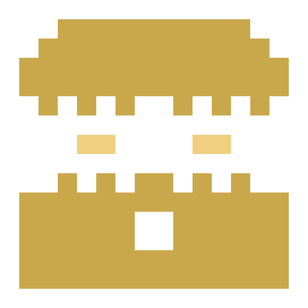
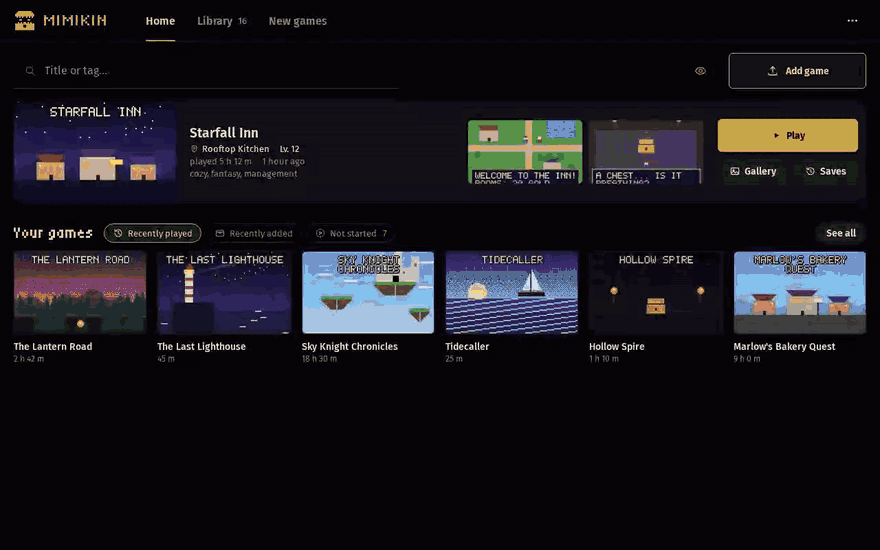
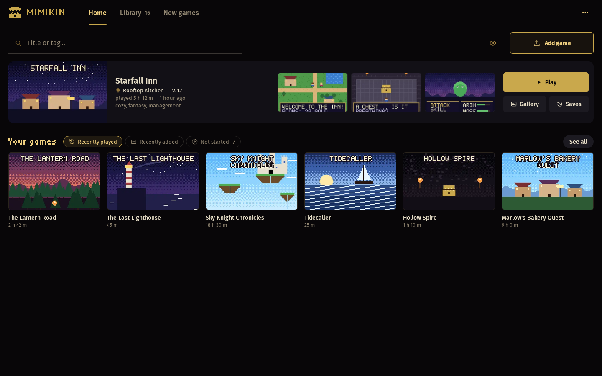
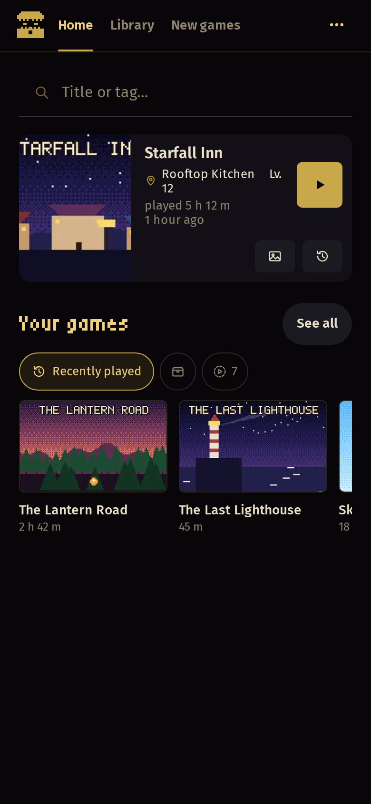
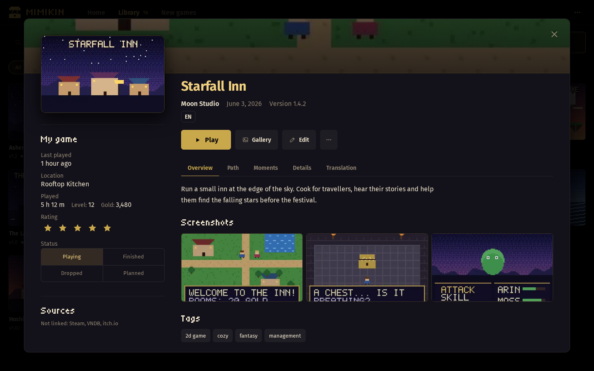
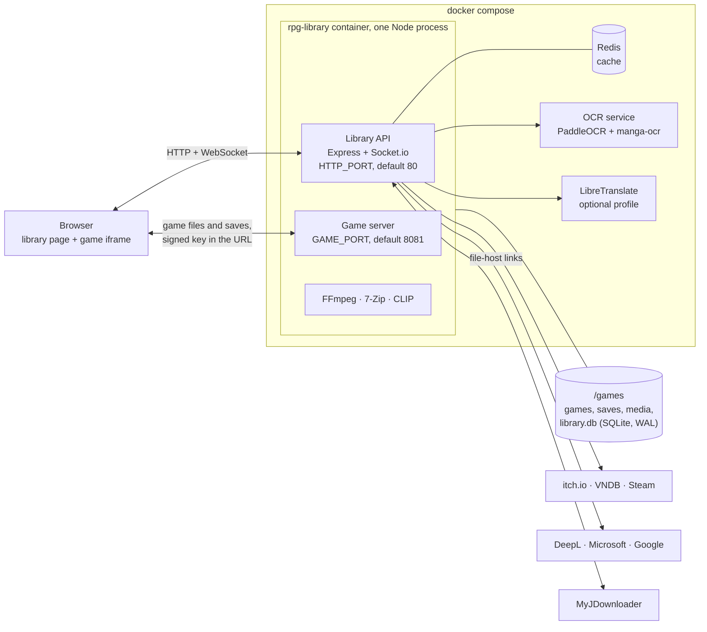
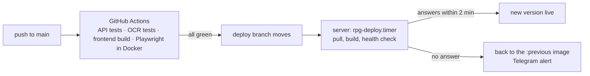

<div align="center">

<picture>
  <source media="(prefers-color-scheme: light)" srcset="rest/img/mimikin-light.png">
  
</picture>

# Mimikin

A self-hosted library for RPG Maker MV and MZ games. Upload the archive and the game runs in a browser tab, phone included.

English | [Русский](README.ru.md) | [Deutsch](README.de.md)

[](https://github.com/Raven632/rpg-library/releases)
[](https://github.com/Raven632/rpg-library/actions)
[](LICENSE)

[](#quick-start)



</div>

RPG Maker MV and MZ games are HTML5 apps packed into NW.js. Mimikin serves the game folder from your server and replaces the NW.js parts with browser code (`api/public/rpg-fixes.js`), so a Windows build runs in Safari on an iPhone. Saves are stored on the server: start at the desk, finish on the couch.

Around the player sits a library. It pulls covers and descriptions from itch.io, VNDB and Steam, builds a gallery out of the game's own image files, and can machine-translate a game without changing a byte on disk.

The logo is a mimic, the treasure chest that bites. It lives in the page header. It chews while the server is busy, snaps shut when you press Play, and hops and drops a coin when a new game lands on the shelf. Press `H` to hide the covers and it closes its eyes.

<table>
  <tr>
    <td width="78%" valign="top"></td>
    <td width="22%" valign="top"></td>
  </tr>
  <tr>
    <td align="center"><sub>The library. Every title is made up; the demo set ships with the repo.</sub></td>
    <td align="center"><sub>Same library, phone.</sub></td>
  </tr>
  <tr>
    <td colspan="2"></td>
  </tr>
  <tr>
    <td colspan="2" align="center"><sub>The game window: cover, status and Play on the left, summary and tabs on the right.</sub></td>
  </tr>
</table>

## What it does

### Play

- PC builds run in a phone browser. `rpg-fixes.js` fills in what NW.js would provide: file access, sound on iPhone, videos, fonts, folder names in the wrong letter case.
- Saves live on the server. Overwritten slots go to "Save history" (the last five, then one per 10 minutes, up to 30 per slot). A save made offline never overwrites a newer one from another device.
- `P` keeps a moment: a screenshot plus a save you can play from. The game also sets rewind points before scenes, choices, battles and map changes, and `Backspace` steps back, down to a single line of dialogue. "Path" lists the playthrough day by day.
- An in-game menu: turbo ×3, a cheat menu (party, items, variables, switches, teleport, scene unlock), saving anywhere on the map, on-screen and real gamepads, stretch and smoothing.
- Games are served from a second port. A game's scripts can't reach the library's API or call other sites.

### Gallery

- Built from the game's files, so you don't have to play first: CG, characters and backgrounds sorted into albums, frame sequences played as animation, videos, a sound room, Spine and Live2D models.
- "Watch scene" replays an album the way the game stages it, with dialogue and sound.
- Search by what is drawn, typed in your own language. The CLIP model runs on your server.
- `H` hides the covers and the tab title at once. In a game it also blanks the screen and mutes the sound.

### Library

- Covers, screenshots, descriptions, tags, developer and release date come from itch.io, VNDB and Steam. Every hit is checked against all the names a game has (folder, archive, readme). When nothing fits, the game window lists close candidates under "Maybe it's this one". You can also press "Edit" and paste a link.
- Statuses follow your play time ("Playing", "Not started"). "What to play?" picks something you haven't started.
- New releases from the itch.io catalog by tag, period, price and platform, with a "Want to play" list.
- An audit page: play time, missing metadata, duplicates, the heaviest games, disk use, errors your devices reported. Deleted games stay in the trash for 30 days.
- Uploads of any size, from a phone too. A dropped upload resumes where it stopped, even from another device. Password-protected archives and archives inside archives unpack fine.
- Paste a file-host link and your MyJDownloader fetches it; the library installs whatever arrives. An `_inbox` folder and an SFTP seedbox work the same way.
- Updating a game keeps its saves, play time and metadata. The old version moves to `_old` and comes back with one click.

### Translate

- Machine translation of MV/MZ games on the server: dialogue, plugin parameters, and labels drawn on pictures (PaddleOCR and manga-ocr). The game server swaps the text in while it serves files, so the game on disk stays original and switching translation off is instant.
- Engines run in order: DeepL, Microsoft, Google, LibreTranslate. When one uses up its free monthly quota, the next takes over, and each line is translated once for all games. Keys go into ⋯ → Settings → Translation.

### Run it yourself

- One `docker compose up -d --build`. Redis and the OCR service start with it; LibreTranslate is an optional profile.
- English, Russian and German interface. Changes appear on every open device right away.
- Sign-in allows 10 attempts per 15 minutes. Keys typed into Settings are stored with AES-256-GCM. Telegram, if you connect it, sends finished uploads, a daily backup and problem alerts.
- `deploy/` has systemd units for a nightly backup and a pull-based deploy that goes back to the previous image when the new one doesn't answer within two minutes.

## How it fits together



The library and the games live on two ports. A game reaches its own files and saves only through a signed key in its URL, so even a hostile game script can't read the library.

## How it ships

Every push to `main` runs four GitHub Actions jobs: API tests (Node, Redis, ffmpeg), OCR tests, lint and build of the interface, and 197 Playwright tests in Docker without network access. When all four pass, CI moves the `deploy` branch. The server never asks the GitHub API anything. A systemd timer checks that branch every minute, rebuilds, and waits for the site to answer. If it doesn't answer within two minutes, the script puts the previous image back and sends a Telegram alert.



## Quick start

You need Linux with Docker Engine. Docker Desktop works too, but big archives are slow through its VM. There is no prebuilt image; Compose builds it from this repository.

```bash
git clone https://github.com/Raven632/rpg-library.git
cd rpg-library
cp .env.example .env              # optional; every setting is described inside (comments are in Russian)
docker compose up -d --build      # the first build downloads the OCR models, a few hundred MB
```

Open `http://<server>` and create the owner account. The server starts without a `.env`. These are the settings you are most likely to touch:

| Variable | Default | What it does |
|---|---|---|
| `SESSION_SECRET` | made on first start | Your own key: `openssl rand -hex 64` |
| `HTTP_PORT` | `80` | The library |
| `GAME_PORT` | `8081` | The games. Both ports must be reachable from your devices (home network, Tailscale) |
| `GAMES_HOST_DIR` | `./games` | Where games, saves and the database live |
| `SCRAPER_API_KEY` | none | Free ScraperAPI key (1000 credits a month) for itch.io pages. A page costs 10 credits; `SCRAPER_DAILY_LIMIT` caps a day at 30. VNDB and Steam need no key |
| `TELEGRAM_BOT_TOKEN` | none | Notifications. Then ⋯ → Settings → Notifications → Connect |
| `COMPOSE_PROFILES` | none | `libretranslate` adds a translator of your own (several GB of models, 2 to 4 GB of memory) |

Translator keys, MyJDownloader, the seedbox and the Telegram chat can also be set later in ⋯ → Settings.

To look around first, fill the library with sixteen made-up games:

```bash
docker compose exec rpg-library node scripts/demo-library.js /games
```

<details>
<summary><b>Where files go</b></summary>

`GAMES_HOST_DIR` is mounted as `/games`:

- `/games/<game>`: the games, unpacked. Nothing is ever written into a game's folder.
- `/games/library.db`: the database.
- `/games/_saves`: cloud saves. `_saves/.history` keeps previous versions of slots.
- `/games/_media`: covers, screenshots, gallery index and thumbnails.
- `/games/_old`: previous versions of updated or patched games.
- `/games/_trash`: deleted games, for 30 days.
- `/games/_inbox`: archives to install by themselves.
- `/games/_tmp_uploads`: uploads in progress.

</details>

<details>
<summary><b>Development</b></summary>

```bash
docker compose -f docker-compose.yml -f docker-compose.dev.yml up -d --build
```

The API restarts on its own when `api/src` changes (`node --watch`). Vite serves the interface on port 5173 and looks for the API on `HTTP_PORT` from `.env` (8080 if unset). The game compatibility check runs only on request: `docker compose -f docker-compose.yml -f docker-compose.dev.yml run --rm --build compat`, with `COMPAT_USER` and `COMPAT_PASS` in `.env`.

</details>

<details>
<summary><b>Tests</b></summary>

```bash
(cd api && npm ci && npm test)                # 287 server and HTTP tests; needs ffmpeg, and Redis for http.test.js
(cd frontend && npm ci && npm run lint)       # ESLint
tests/e2e/run.sh                              # 197 Playwright tests in Docker, offline, desktop and phone widths
(cd ocr && python -m unittest test_pipeline)  # 13 OCR tests; needs numpy, pillow, opencv-python-headless
```

The server tests use Node's built-in runner and no network. External sources are faked; uploads and the game server run on real HTTP servers on free ports. A separate check, `tests/compat`, opens every game of a library in headless Chromium and reports the scene it reached. The screenshots above come from a demo library of made-up games (`api/scripts/demo-library.js`).

</details>

## Under the hood

<details open>
<summary><b>Game isolation</b></summary>

Games are served from a separate origin (`GAME_PORT`). A game gets its files and saves only by a key in its address: an HMAC of the session secret, the game and its folder. Signing out or replacing the game changes it, and every path has to stay inside that game's folder. A Content-Security-Policy keeps the game's code from calling other sites, and the library's API checks Fetch Metadata (`Sec-Fetch-Site`), so a game cannot call it either. The library opens the game full-screen in a sandboxed frame and talks to it with `postMessage`.

</details>

<details>
<summary><b>NW.js in the browser</b></summary>

`api/public/rpg-fixes.js` gives PC builds what they expect from NW.js: stand-ins for Node's `fs` and `path`, a per-game `localStorage` namespace, cloud saves with an offline queue and conflict detection, a touch gamepad, the iOS audio unlock, and error reports back to the server.

</details>

<details>
<summary><b>Resumable uploads</b></summary>

Archives go up in pieces sized to the connection (16 to 256 MB) and resume by a file fingerprint: name, size and a hash of the first and last megabyte. That works after a reload or from another device. Unpacking runs in the background and is finished after a server restart. On iOS the response to a large request never resolves, so the page confirms each piece with a short status request instead.

</details>

<details>
<summary><b>Saves and rewind</b></summary>

Writes are atomic (temporary file, then rename). The history per slot is thinned: the last five, then one per 10 minutes, at most 30. Conflicts are decided by the client's save time. Rewind points are saves that carry their playthrough, so rewinding follows the run you are in.

</details>

<details>
<summary><b>Updates and patches without copies</b></summary>

A patch is laid over a hard-linked copy of the game (`cp -al`). Changed files are unlinked before they are replaced, so the previous version keeps its own. Where a patch's files go is found by matching them against the game's files, case-insensitively.

</details>

<details>
<summary><b>Gallery index</b></summary>

Only the first 40 bytes of each picture are read: PNG `IHDR`, WebP `VP8`/`VP8L`/`VP8X` and RPG Maker's encrypted headers give the size. Size and byte density sort pictures into CG, characters, backgrounds and layers. Names group frames into albums, and the game's own events, read from its map and common-event files, give scenes with dialogue. Thumbnails are WebP, made once by FFmpeg. Picture search runs a quantized CLIP model in `onnxruntime-node`.

</details>

<details>
<summary><b>Data lookup</b></summary>

A lookup tracks which sources did not answer (`AsyncLocalStorage`), so "not found" and "could not ask" are different results with their own retry schedule. Titles are cleaned and compared by a Dice coefficient. ScraperAPI requests are capped by a daily credit budget.

</details>

<details>
<summary><b>Translation</b></summary>

Texts are taken from the game's data files, with what is shown told apart from what is code. They are translated by the engine you pick and kept in the database, one record per string for all games. The game server swaps them in as it serves a file, so the game on disk stays the original. Labels on pictures are read by a separate OCR service (`ocr/`, Python, ONNX) and drawn over the picture in the page.

</details>

<details>
<summary><b>Operations</b></summary>

SQLite in WAL mode. Telegram alerts: everything but problems arrives without sound, at most 10 messages an hour. Backups run from the menu or from `rpg-backup.timer` at 04:00; `deploy/backup.sh` writes the archive. The deploy path is described in "How it ships".

</details>

## Stack

| Part | What |
|---|---|
| Server | Node.js 22, Express, Socket.io, SQLite, Redis |
| Interface | React 19, Vite, pixi.js for Spine and Live2D |
| Services | OCR in Python (`ocr/`), LibreTranslate (optional) |
| Tools | FFmpeg, 7-Zip, Docker Engine |
| Tests | Node test runner, Playwright, unittest |
| CI/CD | GitHub Actions, pull-based deploy with systemd timers |

## Status

7.0 is the current release. Mimikin is a one-person project, and I run it on my own home server.

Known limits:

- MV and MZ only. A VX Ace, 2000/2003, WOLF RPG, Ren'Py, Unity or KiriKiri game is recognised on upload and refused with the engine's name.
- Games with heavy custom plugins can fail. `tests/compat` opens every game of a library in headless Chromium and reports how far each one got.
- Picture search downloads its CLIP models from Hugging Face on first use.

Every release is in the [changelog](CHANGELOG.md).

> [!WARNING]
> Running 6.0? Update. In 6.0 a game's address key could be used to read the whole library folder. Back up first (⋯ → Settings → Backups); the database migrates itself on first start. The license also changed from MIT to AGPL-3.0, and game data now comes from itch.io (by link), VNDB and Steam. Settings moved into the library, and a key in `.env` still wins over one typed there.

## License

Copyright © 2026 Raven. Mimikin is free software under the [GNU Affero General Public License v3.0](LICENSE) (AGPL-3.0-only). You may use, study, change and share it. If you share a changed version, or run one for other people over a network, you must publish its source under the same license. Borrowed components and their licenses are listed in [THIRD_PARTY_NOTICES.md](THIRD_PARTY_NOTICES.md).

## Thanks

Mimikin is built on other people's work. PaddleOCR (through RapidOCR) and manga-ocr read the text on pictures. LibreTranslate with Argos models translates without a cloud service. CLIP, in Xenova's ONNX export, powers picture search. pixi-spine and pixi-live2d-display draw the models, FFmpeg makes the thumbnails, 7-Zip opens the archives, and Fira Sans and Tiny5 set the type. Licenses are in [THIRD_PARTY_NOTICES.md](THIRD_PARTY_NOTICES.md).
