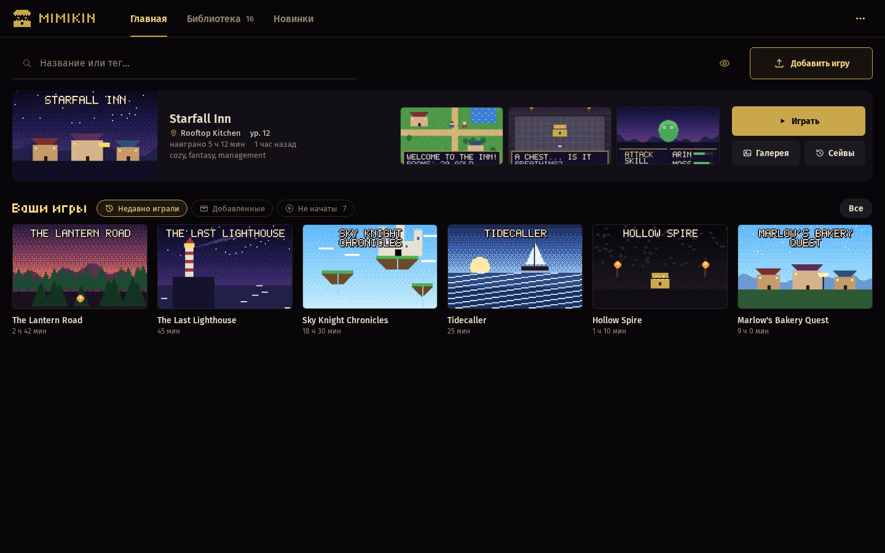
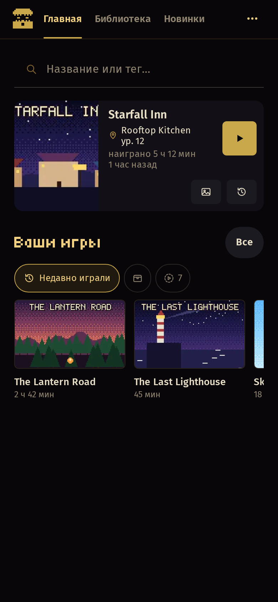
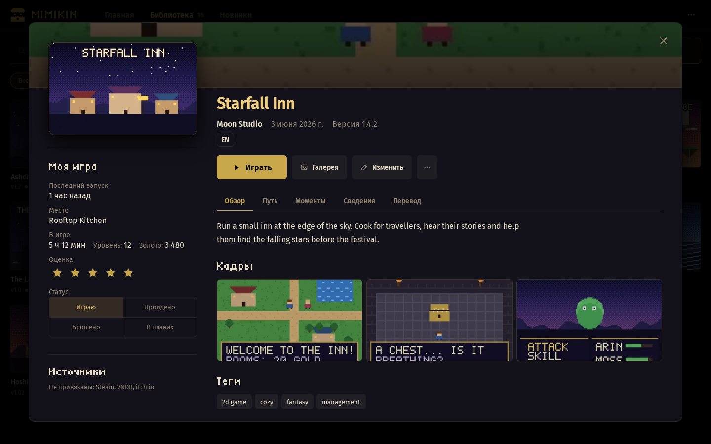
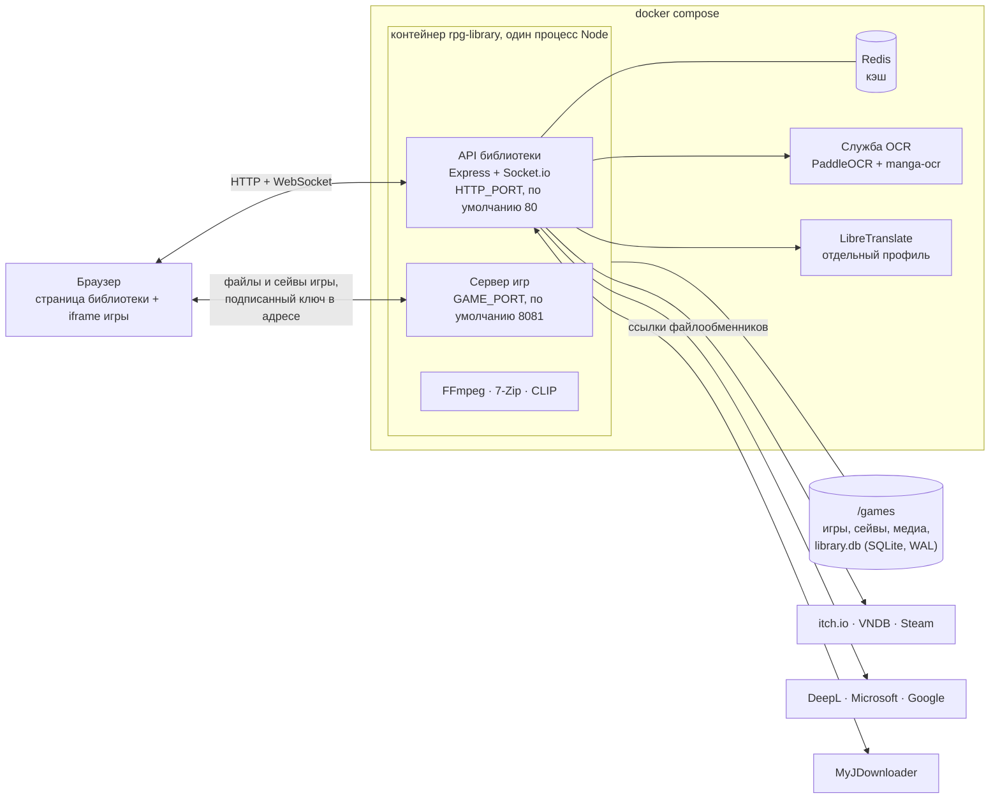
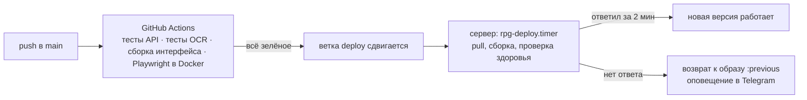

<div align="center">

<picture>
  <source media="(prefers-color-scheme: light)" srcset="rest/img/mimikin-light.png">
  
</picture>

# Mimikin

Библиотека игр на RPG Maker MV и MZ на вашем сервере. Загружаете архив, и игра идёт во вкладке браузера, хоть на телефоне.

[English](README.md) | Русский | [Deutsch](README.de.md)

[](https://github.com/Raven632/rpg-library/releases)
[](https://github.com/Raven632/rpg-library/actions)
[](LICENSE)

[](#быстрый-старт)


</div>

Игры на RPG Maker MV и MZ — это HTML5-приложения, упакованные в NW.js. Mimikin отдаёт папку игры со своего сервера и подменяет части NW.js браузерным кодом (`api/public/rpg-fixes.js`), поэтому сборка для Windows запускается в Safari на iPhone. Сейвы хранятся на сервере: начали за столом, продолжили на диване.

Вокруг этого — библиотека. Она сама берёт обложки и описания с itch.io, VNDB и Steam, собирает галерею из картинок самой игры и умеет машинно перевести игру, не меняя на диске ни байта.

На логотипе мимик — сундук, который кусается. Он живёт в шапке страницы. Пока сервер занят, он жуёт. Когда вы жмёте «Играть», захлопывается, а когда новая игра встаёт на полку, подпрыгивает и роняет монетку. Спрячете обложки клавишей `H` — закроет глаза.

<table>
  <tr>
    <td width="78%" valign="top"></td>
    <td width="22%" valign="top"></td>
  </tr>
  <tr>
    <td align="center"><sub>Библиотека. Все названия вымышлены; демо-набор лежит в репозитории.</sub></td>
    <td align="center"><sub>Она же на телефоне.</sub></td>
  </tr>
  <tr>
    <td colspan="2"></td>
  </tr>
  <tr>
    <td colspan="2" align="center"><sub>Окно игры: слева обложка, статус и «Играть», справа описание и вкладки.</sub></td>
  </tr>
</table>

## Что умеет

### Игра

- ПК-сборки идут в браузере телефона. `rpg-fixes.js` дописывает то, что дал бы NW.js: доступ к файлам, звук на iPhone, ролики, шрифты, папки с неправильным регистром букв.
- Сейвы лежат на сервере. Перезаписанные слоты попадают в «Историю сейвов» (последние пять, затем по одному в 10 минут, до 30 на слот). Сейв, сделанный без сети, не затрёт более свежий с другого устройства.
- `P` запоминает момент: скриншот и сейв, с которого можно играть дальше. Игра сама ставит точки перемотки перед сценами, выборами, боями и сменой карты, а `Backspace` отматывает назад, вплоть до одной реплики. «Путь» перечисляет прохождение по дням.
- Меню в игре: турбо ×3, чит-меню (отряд, предметы, переменные, переключатели, телепорт, открытие сцен), сохранение в любом месте карты, экранный и настоящий геймпад, растягивание и сглаживание.
- Игры отдаются со второго порта. Скрипты игры не достают до API библиотеки и не ходят на чужие сайты.

### Галерея

- Собирается из файлов игры, так что сначала играть не нужно: CG, персонажи и фоны по альбомам, последовательности кадров как анимация, ролики, комната звуков, модели Spine и Live2D.
- «Смотреть сцену» проигрывает альбом так, как его ставит сама игра, с диалогами и звуком.
- Поиск по тому, что нарисовано, на вашем языке. Модель CLIP работает на вашем сервере.
- `H` разом прячет обложки и заголовок вкладки. В игре ещё гасит экран и глушит звук.

### Библиотека

- Обложки, скриншоты, описания, теги, разработчик и дата выхода берутся с itch.io, VNDB и Steam. Каждое совпадение сверяется со всеми названиями игры (папка, архив, readme). Если ничего не подошло, окно игры показывает близких кандидатов под заголовком «Возможно, это она». Можно и нажать «Изменить» и вставить ссылку.
- Статусы следуют за временем игры («Играю», «Не начата»). «Во что поиграть?» выбирает из того, что вы ещё не начинали.
- Новинки из каталога itch.io по тегу, периоду, цене и платформе, со списком «Хочу поиграть».
- Страница аудита: время игры, пустые данные, дубли, самые тяжёлые игры, место на диске, ошибки, которые прислали ваши устройства. Удалённые игры 30 дней лежат в корзине.
- Загрузка любого размера, в том числе с телефона. Оборванная загрузка продолжается с того же места, даже с другого устройства. Архивы с паролем и архивы внутри архивов распаковываются.
- Вставьте ссылку на файлообменник, и ваш MyJDownloader скачает файл, а библиотека установит то, что пришло. Папка `_inbox` и SFTP-сидбокс работают так же.
- Обновление игры сохраняет сейвы, время игры и данные. Старая версия уходит в `_old` и возвращается одним щелчком.

### Перевод

- Машинный перевод игр MV/MZ на сервере: диалоги, параметры плагинов и подписи на картинках (PaddleOCR и manga-ocr). Сервер игр подставляет текст, когда отдаёт файлы, поэтому игра на диске остаётся оригиналом, а выключить перевод можно мгновенно.
- Движки идут по очереди: DeepL, Microsoft, Google, LibreTranslate. Когда у одного кончается бесплатная месячная квота, его место занимает следующий, а каждая строка переводится один раз для всех игр. Ключи вносятся в ⋯ → Настройки → Перевод.

### Запустить у себя

- Одна команда: `docker compose up -d --build`. Redis и служба OCR поднимаются вместе с ней; LibreTranslate включается отдельным профилем.
- Интерфейс на английском, русском и немецком. Изменения сразу видны на всех открытых устройствах.
- Вход допускает 10 попыток за 15 минут. Ключи, введённые в «Настройках», хранятся с шифрованием AES-256-GCM. Telegram, если подключите, присылает готовые загрузки, ежедневный бэкап и сообщения о проблемах.
- В `deploy/` лежат юниты systemd для ночного бэкапа и деплоя по pull-модели: если новый образ не отвечает две минуты, скрипт возвращает предыдущий.

## Как это устроено



Библиотека и игры живут на двух портах. Игра получает свои файлы и сейвы только по подписанному ключу в адресе, поэтому даже враждебный скрипт игры не прочтёт библиотеку.

## Как это выезжает на сервер

Каждый push в `main` запускает четыре задачи GitHub Actions: тесты API (Node, Redis, ffmpeg), тесты OCR, линтер и сборку интерфейса, а также 197 тестов Playwright в Docker без доступа к сети. Когда все четыре зелёные, CI двигает ветку `deploy`. Сервер не обращается к API GitHub. Таймер systemd каждую минуту смотрит на эту ветку, пересобирает образ и ждёт, пока сайт ответит. Если ответа нет две минуты, скрипт возвращает предыдущий образ и шлёт оповещение в Telegram.



## Быстрый старт

Нужен Linux с Docker Engine. На Docker Desktop тоже заработает, но большие архивы идут медленно из-за его виртуальной машины. Готового образа нет: Compose собирает его из этого репозитория.

```bash
git clone https://github.com/Raven632/rpg-library.git
cd rpg-library
cp .env.example .env              # по желанию; каждая настройка описана внутри (комментарии на русском)
docker compose up -d --build      # первая сборка скачивает модели OCR, несколько сотен МБ
```

Откройте `http://<сервер>` и создайте учётную запись владельца. Без `.env` сервер тоже стартует. Вот настройки, которые трогают чаще всего:

| Переменная | По умолчанию | Что делает |
|---|---|---|
| `SESSION_SECRET` | создаётся при первом запуске | Свой ключ: `openssl rand -hex 64` |
| `HTTP_PORT` | `80` | Библиотека |
| `GAME_PORT` | `8081` | Игры. Оба порта должны быть доступны с ваших устройств (домашняя сеть, Tailscale) |
| `GAMES_HOST_DIR` | `./games` | Где лежат игры, сейвы и база |
| `SCRAPER_API_KEY` | нет | Бесплатный ключ ScraperAPI (1000 кредитов в месяц) для страниц itch.io. Страница стоит 10 кредитов; `SCRAPER_DAILY_LIMIT` ограничивает день 30 кредитами. VNDB и Steam ключа не требуют |
| `TELEGRAM_BOT_TOKEN` | нет | Уведомления. Затем ⋯ → Настройки → Уведомления → Подключить |
| `COMPOSE_PROFILES` | нет | `libretranslate` добавляет свой переводчик (несколько ГБ моделей, 2–4 ГБ памяти) |

Ключи переводчиков, MyJDownloader, сидбокс и чат Telegram можно задать и позже, в ⋯ → Настройки.

Чтобы сначала осмотреться, наполните библиотеку шестнадцатью вымышленными играми:

```bash
docker compose exec rpg-library node scripts/demo-library.js /games
```

<details>
<summary><b>Куда что кладётся</b></summary>

`GAMES_HOST_DIR` монтируется как `/games`:

- `/games/<игра>` — игры в распакованном виде. В папку игры никогда ничего не пишется.
- `/games/library.db` — база данных.
- `/games/_saves` — облачные сейвы. `_saves/.history` хранит прежние версии слотов.
- `/games/_media` — обложки, скриншоты, индекс галереи и миниатюры.
- `/games/_old` — прежние версии обновлённых и пропатченных игр.
- `/games/_trash` — удалённые игры, 30 дней.
- `/games/_inbox` — архивы, которые установятся сами.
- `/games/_tmp_uploads` — идущие загрузки.

</details>

<details>
<summary><b>Разработка</b></summary>

```bash
docker compose -f docker-compose.yml -f docker-compose.dev.yml up -d --build
```

API перезапускается сам, когда меняется `api/src` (`node --watch`). Vite отдаёт интерфейс на порту 5173 и ищет API на `HTTP_PORT` из `.env` (8080, если не задан). Проверка совместимости игр запускается только по требованию: `docker compose -f docker-compose.yml -f docker-compose.dev.yml run --rm --build compat`, с `COMPAT_USER` и `COMPAT_PASS` в `.env`.

</details>

<details>
<summary><b>Тесты</b></summary>

```bash
(cd api && npm ci && npm test)                # 287 серверных и HTTP-тестов; нужен ffmpeg, а для http.test.js ещё и Redis
(cd frontend && npm ci && npm run lint)       # ESLint
tests/e2e/run.sh                              # 197 тестов Playwright в Docker, без сети, ширина десктопа и телефона
(cd ocr && python -m unittest test_pipeline)  # 13 тестов OCR; нужны numpy, pillow, opencv-python-headless
```

Серверные тесты идут на встроенном test runner Node (`node:test`) и без сети. Внешние источники подменены; загрузки и сервер игр работают на настоящих HTTP-серверах на свободных портах. Отдельная проверка `tests/compat` открывает каждую игру библиотеки в headless Chromium и сообщает, до какой сцены она дошла. Скриншоты выше сняты с демо-библиотеки вымышленных игр (`api/scripts/demo-library.js`).

</details>

## Под капотом

<details open>
<summary><b>Изоляция игр</b></summary>

Игры отдаются с отдельного адреса (`GAME_PORT`). Свои файлы и сейвы игра получает только по ключу в адресе: это HMAC от секрета сессии, игры и её папки. Выход из аккаунта или замена игры меняют ключ, а любой путь обязан оставаться внутри папки этой игры. Content-Security-Policy не даёт коду игры обращаться к другим сайтам, а API библиотеки проверяет Fetch Metadata (`Sec-Fetch-Site`), так что и к нему игра не обратится. Библиотека открывает игру на весь экран в изолированном фрейме и общается с ней через `postMessage`.

</details>

<details>
<summary><b>NW.js в браузере</b></summary>

`api/public/rpg-fixes.js` даёт ПК-сборкам то, чего они ждут от NW.js: заменители `fs` и `path` из Node, своё пространство `localStorage` для каждой игры, облачные сейвы с очередью на случай обрыва сети и проверкой конфликтов, сенсорный геймпад, разблокировку звука на iOS и отчёты об ошибках на сервер.

</details>

<details>
<summary><b>Докачиваемые загрузки</b></summary>

Архивы уходят кусками по скорости соединения (от 16 до 256 МБ) и докачиваются по отпечатку файла: имя, размер и хеш первого и последнего мегабайта. Это работает после перезагрузки страницы и с другого устройства. Распаковка идёт в фоне и доделывается после перезапуска сервера. На iOS ответ на большой запрос не приходит никогда, поэтому страница подтверждает каждый кусок коротким запросом статуса.

</details>

<details>
<summary><b>Сейвы и перемотка</b></summary>

Запись атомарная (временный файл, затем переименование). История слота прореживается: последние пять, потом по одной на 10 минут, не больше 30. Конфликты решает время сохранения на клиенте. Точки перемотки — это сейвы, которые несут своё прохождение, поэтому перемотка идёт по тому прохождению, в котором вы находитесь.

</details>

<details>
<summary><b>Обновления и патчи без копий</b></summary>

Патч накладывается на копию игры из жёстких ссылок (`cp -al`). Изменённые файлы перед заменой отвязываются, так что прежняя версия сохраняет свои. Куда класть файлы патча, определяется сопоставлением с файлами игры без учёта регистра.

</details>

<details>
<summary><b>Индекс галереи</b></summary>

У каждой картинки читаются только первые 40 байт: размер дают PNG `IHDR`, WebP `VP8`/`VP8L`/`VP8X` и зашифрованные заголовки RPG Maker. Размер и плотность байтов раскладывают картинки по CG, персонажам, фонам и слоям. Имена собирают кадры в альбомы, а события самой игры, прочитанные из файлов карт и общих событий, дают сцены с диалогами. Миниатюры — WebP-файлы, FFmpeg делает их один раз. Поиск по картинкам запускает квантованную модель CLIP в `onnxruntime-node`.

</details>

<details>
<summary><b>Поиск данных</b></summary>

Поиск помнит, какие источники не ответили (`AsyncLocalStorage`), поэтому «не найдено» и «не смогли спросить» — разные результаты со своим расписанием повторов. Названия чистятся и сравниваются по коэффициенту Дайса. Запросы к ScraperAPI ограничены дневным бюджетом кредитов.

</details>

<details>
<summary><b>Перевод</b></summary>

Тексты берутся из файлов данных игры, при этом показываемое отделяется от кода. Выбранный вами движок переводит их, и результат хранится в базе: одна запись на строку для всех игр. Сервер игр подставляет перевод, когда отдаёт файл, так что игра на диске остаётся оригиналом. Подписи на картинках читает отдельная служба OCR (`ocr/`, Python, ONNX), и страница рисует их поверх картинки.

</details>

<details>
<summary><b>Эксплуатация</b></summary>

SQLite в режиме WAL. Оповещения в Telegram: всё, кроме проблем, приходит без звука, не больше 10 сообщений в час. Бэкап делается из меню или по `rpg-backup.timer` в 04:00; архив пишет `deploy/backup.sh`. Путь деплоя описан в разделе «Как это выезжает на сервер».

</details>

## Стек

| Часть | Что |
|---|---|
| Сервер | Node.js 22, Express, Socket.io, SQLite, Redis |
| Интерфейс | React 19, Vite, pixi.js для Spine и Live2D |
| Службы | OCR на Python (`ocr/`), LibreTranslate (по желанию) |
| Инструменты | FFmpeg, 7-Zip, Docker Engine |
| Тесты | Node test runner, Playwright, unittest |
| CI/CD | GitHub Actions, деплой по pull-модели на таймерах systemd |

## Состояние

7.0 — текущий релиз. Mimikin делает один человек, и я сам запускаю его на домашнем сервере.

Известные ограничения:

- Только MV и MZ. Игры на VX Ace, 2000/2003, WOLF RPG, Ren'Py, Unity и KiriKiri распознаются при загрузке, и их отклоняют с названием движка.
- Игры с тяжёлыми самописными плагинами могут не запуститься. `tests/compat` открывает каждую игру библиотеки в headless Chromium и показывает, докуда каждая дошла.
- Поиск по картинкам при первом запуске скачивает модели CLIP с Hugging Face.

Каждый релиз описан в [журнале изменений](CHANGELOG.md).

> [!WARNING]
> Сидите на 6.0? Обновитесь. В 6.0 ключ из адреса игры позволял прочесть всю папку библиотеки. Сначала сделайте бэкап (⋯ → Настройки → Копии); база обновляется сама при первом запуске. Лицензия сменилась с MIT на AGPL-3.0, данные об играх теперь берутся с itch.io (по ссылке), VNDB и Steam. Настройки переехали в библиотеку, а ключ в `.env` по-прежнему главнее введённого там.

## Лицензия

Copyright © 2026 Raven. Mimikin — свободное ПО под [GNU Affero General Public License v3.0](LICENSE) (AGPL-3.0-only). Его можно использовать, изучать, менять и распространять. Если вы распространяете изменённую версию или запускаете её для других людей по сети, вы обязаны опубликовать её исходный код под той же лицензией. Заимствованные компоненты и их лицензии перечислены в [THIRD_PARTY_NOTICES.md](THIRD_PARTY_NOTICES.md).

## Благодарности

Mimikin стоит на чужой работе. Текст на картинках читают PaddleOCR (через RapidOCR) и manga-ocr. LibreTranslate с моделями Argos переводит без облачного сервиса. Поиск по картинкам работает на CLIP в ONNX-сборке Xenova. Модели рисуют pixi-spine и pixi-live2d-display, миниатюры делает FFmpeg, архивы открывает 7-Zip, а шрифты — Fira Sans и Tiny5. Лицензии перечислены в [THIRD_PARTY_NOTICES.md](THIRD_PARTY_NOTICES.md).
